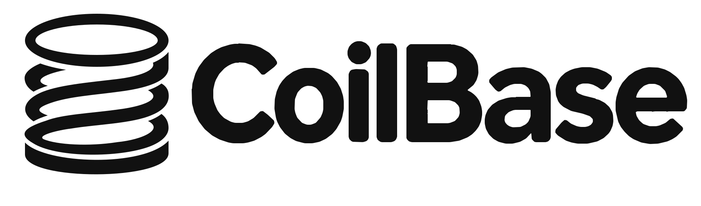

**Spring-like comfort, without the weight.**

## Why CoilBase?

CoilBase is a lightweight foundation for maintainable Java applications. It brings
familiar repository and service organization, explicit transaction boundaries,
and constructor wiring to applications that do not need a large framework runtime.
You keep SQL, business logic and resource ownership visible.

The application structure is familiar to Spring Boot developers: repositories
for data access, services for business logic, and MVC-style controller → service →
repository organization. Controllers and routes use the HTTP framework's native APIs.

Jdbi handles persistence; CoilBase adds repository conveniences, SQL dialect
overrides and explicit rollback-only marking. Core is independent of HTTP frameworks
and DI containers, so repositories, services, SQL and business logic can be reused
across hosts with adaptation at the framework boundary. Optional Avaje Jex integration
supplies HTTP startup, JSON and error-handling conveniences without hiding native
Jex APIs. Jex is the recommended starting point because its integration is straightforward;
for Jex applications, start with annotated
Avaje HTTP controllers with generated routing adapters registered explicitly.
Native Jex routes remain available for custom endpoints.

Experiments have used Avaje Jex, Javalin and Micronaut. Read about
[framework integrations and portability](docs/framework-integrations.md).

### Lightweight runtime

CoilBase is designed for resource-constrained Java deployments. In exploratory
experiments on 512 MiB local VMs, complete CoilBase applications had these median
application RSS measurements across two workload runs:

- **33–51 MiB** with Avaje Jex and GraalVM Native Image.
- **58–59 MiB** with Javalin and GraalVM Native Image.
- **116 MiB** with Avaje Jex on HotSpot JDK 27.

These are workload medians, not framework overhead or guaranteed memory requirements.
Results depend on the application, runtime configuration and deployment. See the
[runtime comparisons](docs/benchmarks.md) for methodology, other frameworks and limitations.

## A small example

Given an application-configured `DataSource dataSource`, Core keeps SQL and
transaction boundaries explicit:

```java
import org.jdbi.v3.core.Jdbi;
import pvrlabs.coilbase.RepositoryContext;

var db = new RepositoryContext(Jdbi.create(dataSource));
db.useHandle(h -> h.execute("CREATE TABLE greetings(message VARCHAR(100))"));

db.transactional(() -> {
    db.update("INSERT INTO greetings(message) VALUES (:message)", update -> update
        .bind("message", "Hello, CoilBase!").execute());
});

var messages = db.query("SELECT message FROM greetings",
    query -> query.mapTo(String.class).list());
System.out.println(messages);
```

[Get started with a runnable HTTP application →](docs/getting-started.md)
H2 is included in the example; no Docker or external database is needed.

## Installation

Experimental; no Maven artifacts are published yet. Build and install this checkout
locally with JDK 21+ and Maven:

```sh
mvn clean install
```

Then add the module you need:

```xml
<dependency>
  <groupId>xyz.pvrlabs</groupId>
  <artifactId>coilbase-core</artifactId>
  <version>0.1.0-preview1</version>
</dependency>
```

Choose `coilbase-jex` instead for the optional Jex integration; it includes Core.
Applications supply their own JDBC driver, datasource or pool, and row mappers.
See [Database Configuration](docs/database-configuration.md) for H2, PostgreSQL
with HikariCP, schema scripts and datasource ownership.

## Monitoring (work in progress)

Optional [StatLite monitoring](docs/statlite-monitoring.md) provides basic
application and JVM metrics for CoilBase applications.

## Modules

| Artifact (group `xyz.pvrlabs`) | Runtime | Contents |
| --- | --- | --- |
| `coilbase-core` | Java 17+ | `pvrlabs.coilbase`: repositories, transactions, SQL selection and optional health/metrics helpers |
| `coilbase-jex` | Java 21+ | `pvrlabs.coilbase.jex`: `CoilBaseJexApplication` and `JexErrors` |

Core depends on Jdbi, with no Jex, Jackson, Avaje HTTP, DI container or annotation
processing requirement. The Jex module intentionally brings Jex and Jackson as
regular transitive dependencies, including Java time support for default ISO-8601 JSON.

## Practical guidance

- **Transactions:** `transactional` defines a synchronous boundary on one datasource.
  Nested managed callbacks join on the same thread and Jdbi instance, without an
  independent commit or savepoint. Escaping exceptions roll back; caught failures
  need `markRollbackOnly()` if the transaction must not commit. Configure the context
  before opening handles. Custom/retrying/container transaction handlers,
  cross-thread propagation and distributed transactions are unsupported.
- **Resources:** consume query results inside callbacks. Do not return handles or
  lazy results that outlive them; close streams and batches explicitly. Applications
  configure datasources. The optional Jex application base closes an `AutoCloseable`
  primary datasource or disposes an H2 `JdbcConnectionPool` on shutdown/startup failure;
  see [Database Configuration](docs/database-configuration.md) for ownership details.
- **Errors:** the Jex base installs safe JSON error handling before calling
  `configureErrorHandling()`. Register typed mappings such as
  `mapError(InvalidNameException.class, 400)`; specific types take
  precedence over mapped superclasses. See [Getting Started](docs/getting-started.md).
- **SQL:** `SqlStatement` selects immutable overrides by configured dialect; it does
  not detect databases or rewrite SQL. A dialect name is not a compatibility guarantee.
  `db.executeScript(sql)` and `db.executeScriptResource("/script.sql")`
  explicitly run scripts through Jdbi, without introducing a transaction or migration tracking.
- **Examples and tests:** the [records example](coilbase-core/src/test/java/pvrlabs/coilbase/example/records)
  demonstrates a service coordinating two repositories. The runnable
  [Hello CoilBase example](examples/hello-coilbase) is a separate Maven project;
  these examples are excluded from library binary and source JARs. Run `mvn clean verify` for the H2-backed
  persistence tests and Jex HTTP tests; these do not certify every database dialect.

CoilBase has a deliberately narrow scope: it is not a DI container, an ORM,
or an abstraction over every Java HTTP framework. There is no automatic migration.
Services and repositories
can remain independent of the HTTP host; routes, controllers and bootstrap use that
host's native APIs. Plain Jdbi remains a good choice when these conventions add no value.

For standalone consumer and parent-POM resolution checks, see
[consumer verification](verification/README.md). Maven distribution includes the
parent POM and both modules; applications depend only on the modules they need.

Licensed under [Apache-2.0](LICENSE). Dependencies retain their respective licenses.
